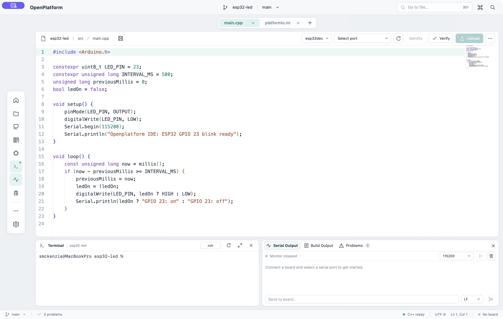

# OpenPlatform

A focused macOS workspace for Arduino and ESP32 development. Built with Tauri, React, Monaco and PlatformIO.



**Documentation updated: 27 October 2026.** This describes the current workspace, including the source-control and Accounts changes made after the `v1.0.0` checkpoint. Those changes are recorded as unreleased until a new version is published.

## Latest changes — 27 October 2026

- Expanded source control with repository initialization, working and staged file lists, individual and bulk staging/unstaging, diff previews, commits, branch creation and switching, and commit history.
- Added GitHub CLI sign-in and account switching, private or public repository publishing, and controls for connecting an existing `origin`, fetching, pulling and pushing. Pulls fast-forward only; a divergent history is reported instead of being merged automatically.
- Moved Git author and GitHub account details to **Settings → Accounts**. Fields are locked until **Edit** is selected. The author preference is stored locally for commits made in OpenPlatform; Git's existing author configuration is used when no preference is saved.
- Added a last-sign-in indicator that advances after each elapsed 24-hour period. It records successful sign-ins performed through the updated IDE; earlier or external sign-ins show **Not recorded**. GitHub CLI manages authentication credentials; the IDE does not display or store access tokens in Settings.
- Checked the source-control interface with disposable local repositories and a controlled GitHub CLI fixture, and verified repository creation, push, fetch and pull against a new private GitHub test repository. See [GitHub and source control](docs/github-source-control.md) for the workflow and validation limits.

## Version 1 workspace

- A light, compact editor with teal accents, centered open-file tabs, a minimap, breadcrumbs and syntax highlighting.
- A short floating dock with small icons and hover/focus labels. Choose visible tools in Settings; the dock grows or shrinks to fit.
- A persistent terminal beside a separate window for Serial Output, Build Output and Problems. Both windows can stay open together.
- Native macOS menus for File, Edit, View, Build, Tools and Window. File actions are in the system menu bar rather than inside the workspace.
- Consistent floating panels for projects, files, outline, GitHub, libraries, boards, basic OpenOCD controls and appearance settings.

## Development tools

- New, open and recent projects; ESP32, Arduino Uno and Nano templates; native Save / Save As dialogs.
- Monaco C/C++ editing with clangd completion, hover, definitions, references, formatting and live diagnostics.
- Project search, file finder, command palette, preview tabs and unsaved-file recovery.
- Explicit PlatformIO build environment and USB serial port selection; identify, verify, upload and cancel controls.
- Real PTY terminal with persistent scrollback and shell restart.
- Serial receive/send, baud selection, None/LF/CRLF endings and automatic monitor release/resume around uploads.
- Compiler diagnostics in the Problems view. Build, clean, test, analysis, dependency installation and compilation database commands.
- Git status, individual and bulk staging/unstaging, diff previews, commits, branch creation/switching, recent history, fetch, fast-forward pull, push and GitHub publishing.
- PlatformIO library search/install and searchable board catalogue. Configure the selected board in `platformio.ini`.

## Run locally

Requires Node.js/npm, Rust, Git, PlatformIO Core and clangd. GitHub sign-in, account switching and publishing use the GitHub CLI (`gh`); basic hardware debugging uses OpenOCD and a compatible JTAG probe.

```sh
npm install
npm run tauri dev
```

Build the macOS application:

```sh
npm run tauri -- build --debug --bundles app
```

The local app is written to `src-tauri/target/debug/bundle/macos/OpenPlatform.app`. This is a development build, not a signed/notarized installer.

## Keyboard shortcuts

| Shortcut | Action |
| --- | --- |
| ⇧⌘P | Command palette |
| ⌘P | Go to file |
| ⇧⌘F | Find in project |
| ⌘O / ⇧⌘N | Open / new project |
| ⌘N | New file |
| ⌘S / ⌥⌘S / ⇧⌘S | Save / save all / save as |
| ⌘W | Close tab |
| ⌘B | Toggle auxiliary panel |
| ⌃` | Toggle terminal |
| ⌘, | Settings |

For C++ navigation, run **Build → Generate Compilation Database** after opening a new project or changing its environment. F12 goes to a definition. Appearance settings and dock visibility are remembered locally.

Tool executable overrides are `OPENPLATFORM_PIO`, `OPENPLATFORM_CLANGD`, `OPENPLATFORM_CODE` and `GH_PATH`. `OPENPLATFORM_PROJECT` selects the initial project; otherwise the most recent existing project opens.

## GitHub setup

1. Open **Settings → Accounts**, select **Edit**, and save a Git author name and email. To connect GitHub, select **Sign in to GitHub** and complete the GitHub CLI browser authorization.
2. Open the GitHub icon in the dock. Initialize the repository if needed, review and stage files, enter a commit message, and commit.
3. Publish a new private or public repository, or connect an existing `origin`. Use Fetch, Pull and Push for subsequent updates. If the project sits inside a parent Git repository, staging controls apply to that entire repository; the panel displays its root.

Changing the GitHub username in Accounts switches to an account already authenticated in GitHub CLI; it does not edit the profile hosted by GitHub. **Sign in another account** starts another device flow. [The source-control guide](docs/github-source-control.md) covers credential handling, limitations and troubleshooting context.

## Source-control checks — 27 October 2026

The frontend and macOS debug app builds passed. Disposable local Git tests covered staged and unstaged changes, commits, branches, push/fetch/pull and divergent-pull handling. A CLI fixture covered account-status, account-switch and repository-publish command handling, while a live private GitHub test covered repository creation, push, fetch and pull. Account locking and the Git workflow were also checked in a separate native QA build.

The revised last-sign-in recording and switching between two real GitHub accounts have not yet been tested end to end. The private GitHub test repository was left in place because the current CLI permissions did not report repository-deletion access.

To run the focused local checks (Node 22.6 or later):

```sh
node --experimental-strip-types --test scripts/accountAuthor.test.ts scripts/accountTime.test.ts
cargo test --manifest-path src-tauri/Cargo.toml source_control::
```

The controlled GitHub CLI fixture and live GitHub test are opt-in; the ordinary backend command above does not create a hosted repository.

## v1 validation

The v1 design pass was checked with a production frontend build, a native macOS debug bundle, and focused visual checks of the workspace, native File menu and dock customization. A full regression or hardware test pass was intentionally outside this layout-focused change.

The [earlier capability review](docs/ide-capabilities.md) records backend validation from 24 October; its roadmap is historical and predates the current Git, board and library panels. The [v1 layout notes](docs/design-v1.md) describe the original presentation, and the [changelog](CHANGELOG.md) records dated changes.
